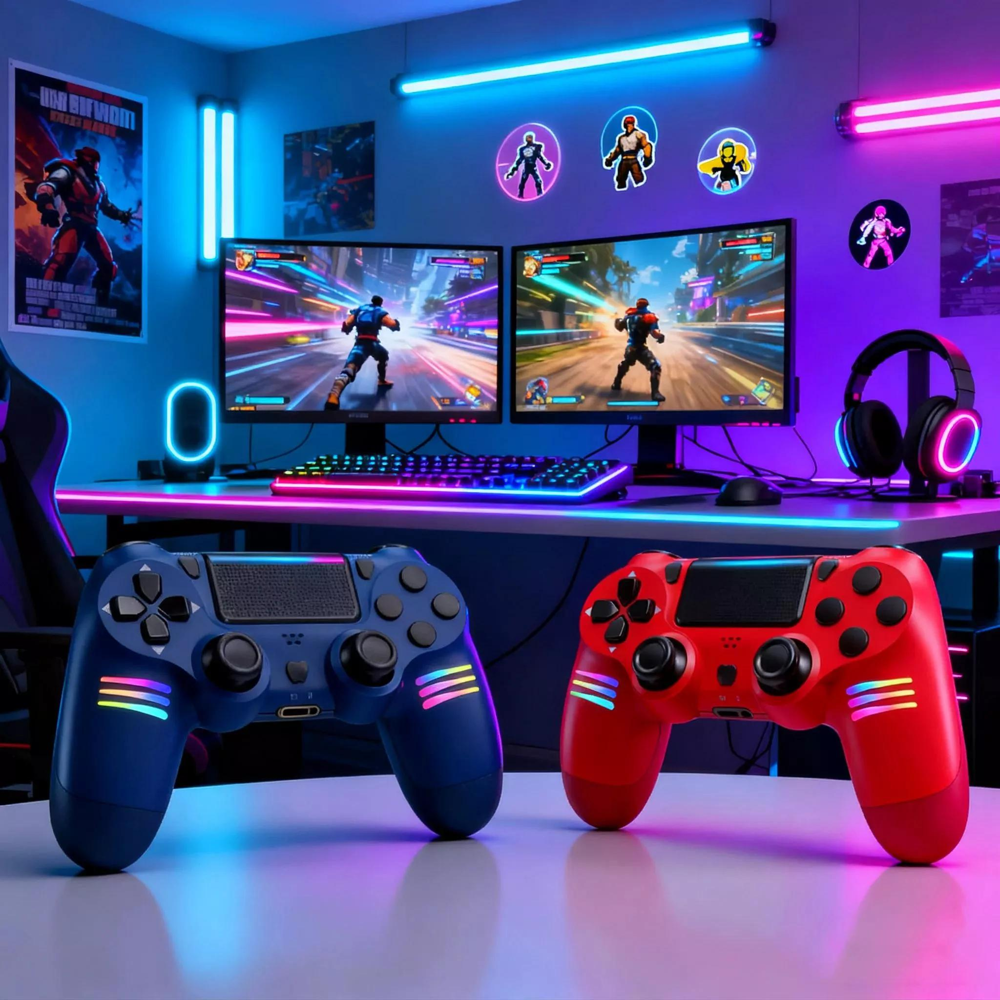

# GameZone: Mundo de Videojuegos

## Descubre tus juegos favoritos

Bienvenido a **GamerZone**, una página dedicada a los amantes de los videojuegos. Aquí encontrarás *noticias, recomendaciones y trucos*.

## 1. Tipos de videojuegos

- Acción y aventura
- Deportes
- Terror
- Carreras

## 2. Mis juegos favoritos

1. Minecraft
2. Fortnite
3. GTA V

## 3. Ejemplo de código

```python
juego = "Minecraft"
print("Mi juego favorito es", juego)
```

## 4. Imagen de videojuegos



## 5. Enlaces interesantes

[Información sobre videojuegos](https://es.wikipedia.org/wiki/Videojuego)

[Ver detalles](docs/detalles.md)

## 6. Tabla de videojuegos

| Juego | Género | Plataforma |
|---|---|---|
| Minecraft | Aventura | PC |
| Fortnite | Acción | PC y consola |
| FIFA | Deportes | Consola |

## Conclusión

Los videojuegos fomentan la creatividad y la estrategia.

**¡Bienvenido a GamerZone!**
